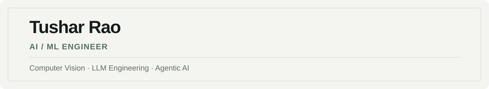
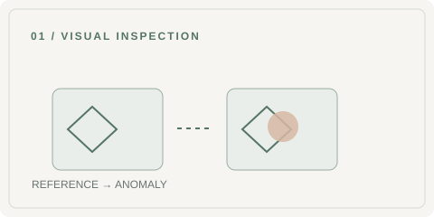
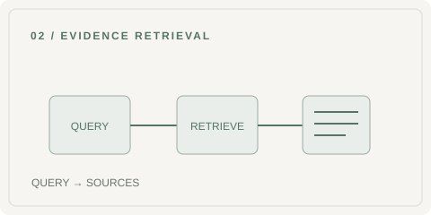
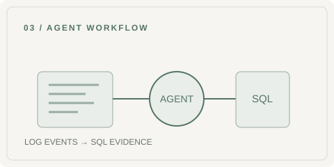

<picture>
  <source media="(prefers-color-scheme: dark)" srcset="./assets/header-dark.svg">
  <source media="(prefers-color-scheme: light)" srcset="./assets/header-light.svg">
  
</picture>

  <a href="https://tusharrao.dev"><strong>Portfolio ↗</strong></a> &nbsp;·&nbsp;
  <a href="https://github.com/Tushar-94?tab=repositories"><strong>Repositories ↗</strong></a>

### 01 / Selected work

<table>
<tr>
<td width="50%" valign="top">
<h3>Industrial Vision Anomaly Detection</h3>

COMPUTER VISION · DINOV2 · FEW-SHOT

Reference-based industrial inspection, ROI masking, and calibrated anomaly scoring.

<a href="https://tusharrao.dev/projects/industrial-vision-anomaly-detection">Explore project ↗</a>
</td>
<td width="50%" valign="top">
<h3>Industrial Knowledge Copilot</h3>

LLM ENGINEERING · RAG · RETRIEVAL

Evidence-grounded answers from manufacturing documents, with retrieval evaluation and source traceability.

<a href="https://tusharrao.dev/projects/industrial-knowledge-copilot">Explore project ↗</a>
</td>
</tr>
</table>

<table>
<tr>
<td width="50%" valign="top">
<h3>LogIQ AI Agent</h3>

AGENTIC AI · TOOL CALLING · SQL

Role-aware log investigations using an LLM and 19 SQL-backed tools.

<a href="https://tusharrao.dev/projects/logiq-ai-agent">Explore project ↗</a>
</td>
<td width="50%" align="center" valign="middle">
 

<h3>How I work</h3>

From problem framing to evaluation, I focus on reproducible experiments, clear engineering decisions, and systems that can be tested—not just demonstrated.

<a href="https://tusharrao.dev/projects">View all projects ↗</a>

</td>
</tr>
</table>

### 02 / Engineering toolkit

| Focus | Tools & methods |
| :--- | :--- |
| **Computer vision** | PyTorch · OpenCV · YOLO · DINOv2 |
| **LLM systems** | RAG · Qdrant · Hybrid search · Tool calling |
| **Machine learning** | Scikit-learn · XGBoost · Evaluation |
| **Systems** | Python · SQL · FastAPI · Docker · Kubernetes |

### 03 / Currently exploring

**Few-shot visual inspection** &nbsp; / &nbsp; **Evidence-grounded LLMs** &nbsp; / &nbsp; **Reliable AI agents**

---

Engineering intelligence. Building what matters. &nbsp; · &nbsp; <a href="https://tusharrao.dev">tusharrao.dev</a>
